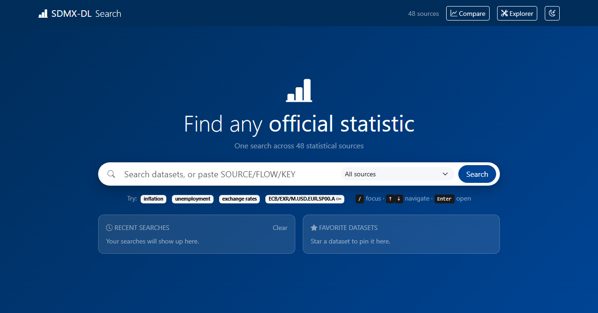
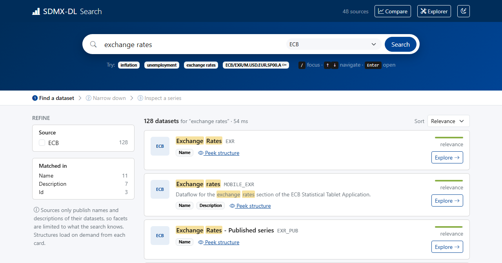
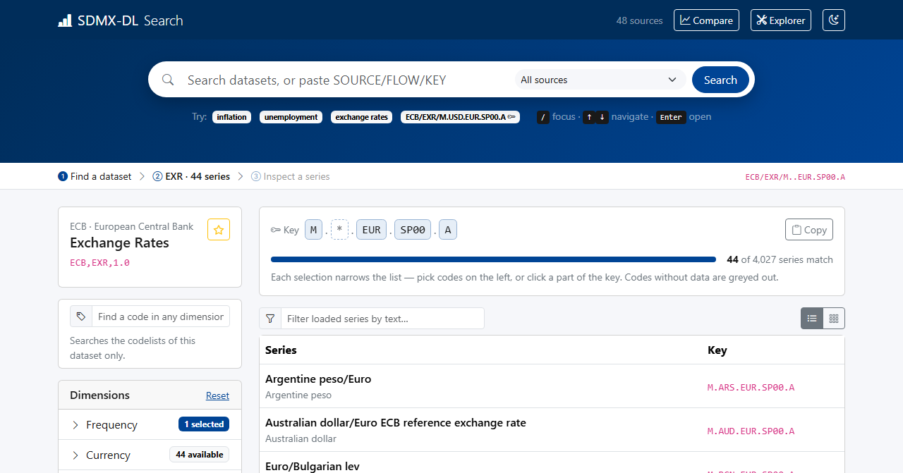
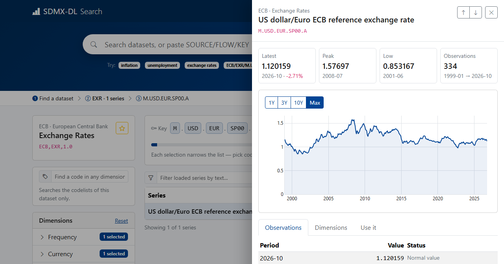

The [web service]() also ships with **SDMX-DL Search**, a web page to find official statistics without knowing which source publishes them, nor how their keys are built.  
Once the service is running, open [http://localhost:4559/search.html](http://localhost:4559/search.html) (adjust the port if you changed `quarkus.http.port`).

Like the [API Explorer](), it only uses the [REST endpoint]() of the same server and serves all its resources itself.
The **Explorer** button of the top bar opens the API Explorer.

## Steps

The page guides you through three steps, shown in the bar below the search box; click a step to go back to it.

### 1. Find a dataset

The search box is centered on the landing screen, with your recent searches and favorite datasets below it, and moves to the top once you search.
It looks for datasets in all the sources at once (see [Flows across sources]()), or in the source picked next to it.
While you type, it suggests the best matching datasets; use the arrow keys and **Enter**, or click a suggestion, to open it.
Press **/** anywhere to focus the search box.

You can also type or paste a reference such as `ECB/EXR` or `ECB/EXR/M.USD.EUR.SP00.A` to open a dataset, with a key, directly.

Results are sorted by relevance (or by name), highlight the words of the search and can be filtered by source.
Sources that could not be searched are listed above the results.
**Peek structure** loads the dimensions of a dataset without leaving the list.

### 2. Narrow down

The dataset view lists the dimensions on the left: pick codes to narrow the [key](), shown above the series.
Codes without data for the current selection are greyed out (see [Availability]()); if the source does not support it, all codes are kept.
**Find a code** searches the codes of all dimensions at once, e.g. a country name.

The counter tells how many series match the selection, and the list shows them page by page (**Load more**), as a table or as cards.
The star button adds the dataset to your favorites.

### 3. Inspect a series

Clicking a series opens a panel with its latest value, peak, low and number of observations, a chart with a range selector, and three tabs:

- **Observations**: the values with their status, most recent first.
- **Dimensions**: the codes of the series and its attributes, with their labels.
- **Use it**: a script that fetches the series, for each [script target](), to copy or download.

**Download CSV** saves the observations, and the arrow buttons (or the arrow keys) move to the previous or next series.

## Compare

**Add to compare** keeps up to five series, possibly from different datasets and sources; the **Compare** button of the top bar plots them on the same chart.

## Saved in the browser

Recent searches, favorite datasets and compared series are saved in the local storage of the browser; nothing is sent to the server.

## URL parameters

The address of the page reflects the current step, so you can bookmark or share it, and the back and forward buttons move between steps.

| Parameter                    | Description                                  | Example                                        |
|------------------------------|----------------------------------------------|------------------------------------------------|
| `q`                          | Search text                                  | `?q=exchange+rates`                            |
| `scope`                      | Source to search in (all sources by default) | `?q=inflation&scope=ESTAT`                     |
| `source`, `flow`, `database` | Dataset to open                              | `?source=ECB&flow=EXR`                         |
| `key`                        | Selection in the dataset, as a key           | `?source=ECB&flow=EXR&key=M..EUR.SP00.A`       |
| `series`                     | Series to inspect in the dataset             | `?source=ECB&flow=EXR&series=M.USD.EUR.SP00.A` |
| `view`                       | `compare` to open the comparison             | `?view=compare`                                |

For example, [http://localhost:4559/search.html?source=ECB&flow=EXR&key=M..EUR.SP00.A](http://localhost:4559/search.html?source=ECB&flow=EXR&key=M..EUR.SP00.A) lists the monthly exchange rates of the euro.
