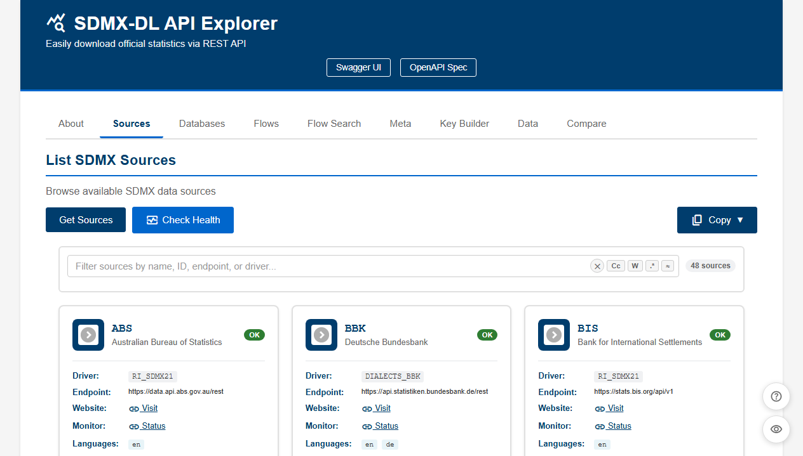
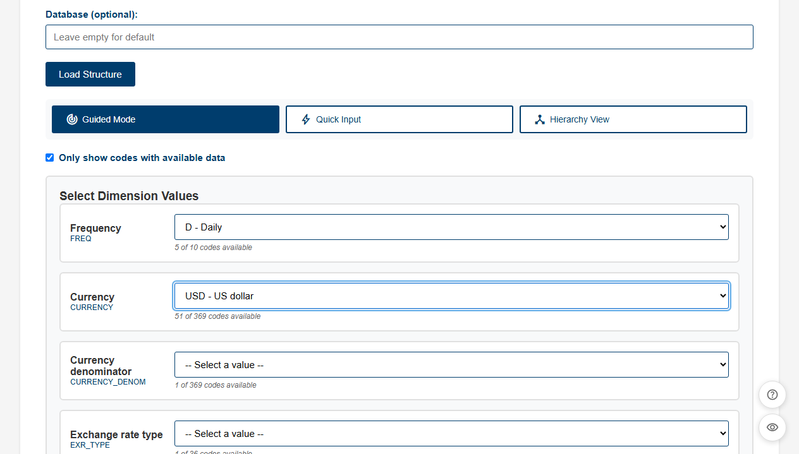
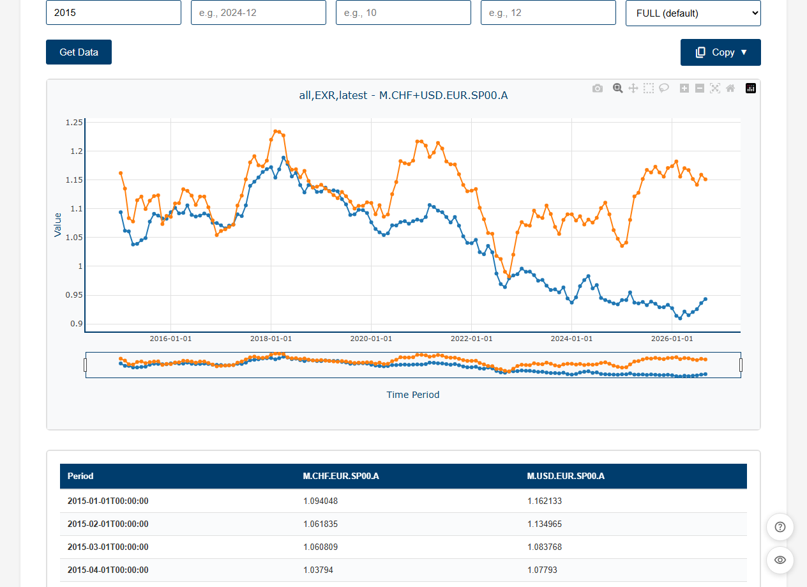
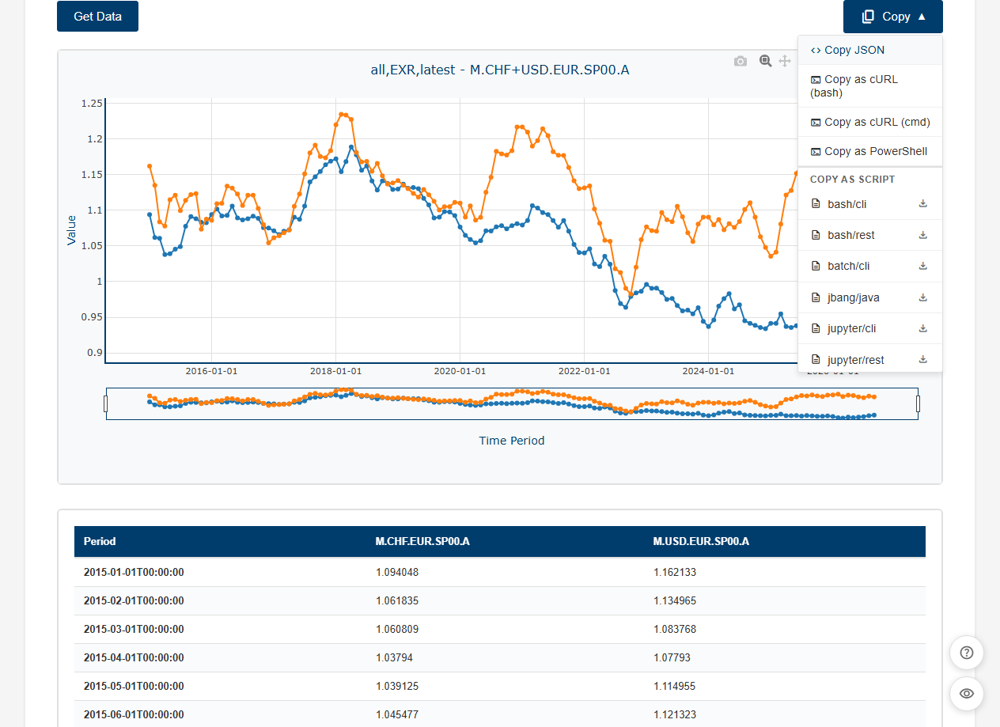

The [web service]() ships with **SDMX-DL API Explorer**, a web page to browse sources and fetch data from a browser, without writing any code.  
Once the service is running, open [http://localhost:4559/](http://localhost:4559/) (adjust the port if you changed `quarkus.http.port`).

The page uses the [REST endpoint]() of the same server, so everything you do in it can be reproduced with an HTTP client.  
It also links to the [OpenAPI UI](http://localhost:4559/q/swagger-ui) and to the [OpenAPI specification](http://localhost:4559/q/openapi).



## Tabs

Each tab covers one step of the usual [discover → browse → retrieve]() workflow.
Cards and results have shortcuts to send the current source, flow or key to the next tab.

| Tab         | Description                                                                                                                                       | REST operation                                  |
|-------------|---------------------------------------------------------------------------------------------------------------------------------------------------|-------------------------------------------------|
| About       | Name and version of sdmx-dl.                                                                                                                      | `GET /about`                                    |
| Sources     | Source cards with driver, endpoint, website, monitor, languages and properties. **Check Health** gives a verdict for all sources; the **Health** action of a card also performs a live request. | `GET /sources`, `GET /health`, `GET /{source}/health` |
| Databases   | Databases of a source.                                                                                                                            | `GET /{source}/databases`                       |
| Flows       | Flows of a source, optionally in a database.                                                                                                      | `GET /{source}/flows`                           |
| Flow Search | Searches the flows of all sources at once. Flows are indexed once and kept in the browser; results can be exported to CSV.                       | `GET /sources`, `GET /{source}/flows`           |
| Meta        | Structure of a flow: dimensions with a preview of their codes, and attributes.                                                                    | `GET /{source}/{flow}/meta`                     |
| Key Builder | Builds a [key]() from the dimensions of a flow (see [below](#key-builder)).                                   | `GET /{source}/{flow}/meta`, `GET /{source}/{flow}/availability` |
| Data        | Fetches series as a chart and a table, optionally narrowed by period, observation count or detail (see [below](#data)).                          | `GET /{source}/{flow}/data`                     |
| Compare     | Plots several series, possibly from different sources, on the same chart.                                                                         | `GET /{source}/{flow}/data`                     |

All paths above are relative to `/sdmx-dl/v2`.

Lists of sources, flows and search results can be filtered as you type, with options for match case, whole words, regular expressions and fuzzy matching.

The health verdict of a source is one of `OK`, `DEGRADED`, `LOCAL_ISSUE`, `REMOTE_OUTAGE`, `UNREACHABLE` or `UNKNOWN`; hover the badge for the details (see [Monitor and status]()).

### Key Builder

The Key Builder loads the dimensions of a flow and their codes, and offers three ways to fill them:

- **Guided mode**: one drop-down list of codes per dimension.
- **Quick input**: type the key directly, with autocompletion of the codes of the current dimension.
- **Hierarchy view**: pick one dimension after the other, as in a tree.

In every mode, `+` (or an empty part) means all the codes of a dimension.

Check **Only show codes with available data** to restrict the codes to those that actually have data, given the codes already selected in the other dimensions (see [Availability]()).
This is useful for large code lists, but it sends one request per dimension to the source; if the source doesn't support it, the full code lists are kept.



The generated key can then be copied, or used in the Data and Compare tabs.

### Data

The Data tab fetches the series of a key and shows them as an interactive chart and a table.
Periods are labelled according to their frequency (e.g. `2024`, `2024-Q1`, `2024-01`), and series are named by their title when the source provides one, otherwise by their key.
Optional fields narrow the query, like the parameters of the [REST endpoint]():

| Field            | REST parameter | Description                                                   |
|------------------|----------------|---------------------------------------------------------------|
| Start period     | `start`        | First period to retrieve (e.g. `2020` or `2020-01`).          |
| End period       | `end`          | Last period to retrieve.                                      |
| First N obs      | `firstN`       | Maximum number of observations per series, from the start.    |
| Last N obs       | `lastN`        | Maximum number of observations per series, from the end.      |
| Detail           | `detail`       | `FULL` (default), `DATA_ONLY`, `SERIES_KEYS_ONLY` or `NO_DATA`. |

See [Retrieve]() for their meaning.



## Copy and scripts

Once a tab has loaded, its **Copy** menu offers:

- **Copy JSON**: the raw response of the REST endpoint.
- **Copy as cURL (bash)**, **cURL (cmd)** or **PowerShell**: the same request, ready to paste in a terminal.
- **Copy as script** (Flows and Data tabs): a script that performs the same request in another language, for each [script target](). Click a target to copy the script, or its download icon to save it as a file.



## URL parameters

The address of the page reflects the current tab and form fields, so you can bookmark or share it.
The same parameters can be used to open the page in a given state:

| Parameter                 | Description                                                                                         | Example                                  |
|---------------------------|-----------------------------------------------------------------------------------------------------|------------------------------------------|
| `tab`                     | Tab to open: `sources`, `databases`, `flows`, `flowsearch`, `meta`, `keybuilder`, `data`, `compare` | `?tab=keybuilder`                        |
| `source`, `flow`, `database` | Pre-fill the fields of the tab                                                                   | `?tab=meta&source=ECB&flow=EXR`          |
| `key`                     | Pre-fill the key (Data and Compare tabs)                                                            | `?key=M.USD.EUR.SP00.A`                  |
| `start`, `end`            | Pre-fill the period range (Data tab)                                                                | `?start=2020&end=2024-12`                |
| `firstN`, `lastN`         | Pre-fill the observation count (Data tab)                                                           | `?lastN=12`                              |
| `detail`                  | Pre-fill the detail (Data tab)                                                                      | `?detail=SERIES_KEYS_ONLY`               |
| `label`                   | Pre-fill the series label (Compare tab)                                                             | `?label=USD`                             |
| `hideHeader`              | Hide the header                                                                                     | `?hideHeader=true`                       |
| `hideOtherTabs`           | Hide all tabs except the selected one                                                               | `?hideOtherTabs=true`                    |
| `callback`                | URL that receives the key built in the Key Builder (see [below](#embedding))                        | `?callback=http://localhost:8080/keys`   |

For example, [http://localhost:4559/?tab=data&source=ECB&flow=EXR&key=M.USD.EUR.SP00.A&lastN=12](http://localhost:4559/?tab=data&source=ECB&flow=EXR&key=M.USD.EUR.SP00.A&lastN=12) opens the Data tab ready to fetch the last 12 monthly USD/EUR exchange rates.

The **?** button at the bottom right of the page lists these parameters, and the **eye** button toggles the header and the other tabs.

## Embedding

The Key Builder can serve as a key picker for another application:

1. Open the page, for example in a pop-up, with `tab=keybuilder`, a `callback` URL and optionally `hideHeader=true&hideOtherTabs=true`.
2. The user builds a key and clicks **Send**, which replaces the usual actions.
3. The page sends a `POST` request to the callback URL with a JSON body, then closes itself if it was opened as a pop-up:

```json
{ "source": "ECB", "flow": "EXR", "database": "", "key": "M.USD.EUR.SP00.A" }
```

The callback is called from the browser, so it must be reachable from the user's machine and allow [cross-origin requests](https://developer.mozilla.org/en-US/docs/Web/HTTP/CORS) from the web service.
